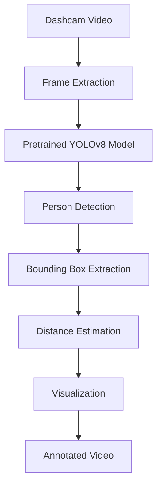

# Pedestrian Detection and Distance Estimation Using Pretrained YOLOv8

An academic mini-project that detects pedestrians in dashcam video using official
Ultralytics YOLOv8 models and overlays an approximate monocular distance estimate.

## Features

- Person-only YOLOv8 inference using the COCO `person` class.
- Selectable model size: YOLOv8n for speed and YOLOv8s as the recommended
  accuracy/speed balance.
- Configurable confidence threshold, assumed pedestrian height, and focal length.
- Bounding boxes, confidence, pedestrian count, and approximate distance overlays.
- Streamlit upload, preview, download, progress, and summary statistics.
- Preserves input video FPS and resolution where the codec permits.

## Architecture



## Installation and usage

Use Python 3.10+ in a virtual environment:

```bash
python -m venv .venv
# Windows PowerShell
.\.venv\Scripts\Activate.ps1
# macOS/Linux: source .venv/bin/activate
pip install -r requirements.txt
streamlit run app.py
```

Open the displayed local URL, upload a `.mp4`, `.avi`, `.mov`, or `.mkv` dashcam video, choose
settings, and select **Run pedestrian analysis**. The first model load may download the selected
weights file, such as `yolov8s.pt`.

For a local sample, place it at `sample/dashcam.mp4`. The Streamlit app is the supported test
interface; processed outputs can be downloaded from the UI. The `outputs/` directory is reserved
for generated files when extending the project for batch processing.

## Distance-estimation methodology

For a detected pedestrian, the bounding-box pixel height is used in the pinhole-camera relation:

`D = (H × F) / h`

where `H` is assumed pedestrian height in metres, `F` is focal length in pixels, and `h` is
bounding-box height in pixels. Focal length can be calibrated using:

`F = (h × known distance) / known height`

This is an approximation, not metric ground truth. Accuracy depends on calibration, actual height,
camera angle, box quality, perspective, and lens characteristics.

## Folder structure

```text
├── app.py
├── src/
│   ├── detector.py
│   ├── distance_estimator.py
│   └── video_processor.py
├── sample/README.md
├── outputs/.gitkeep
├── report/project_report.md
├── requirements.txt
└── .gitignore
```

## Limitations and future work

The demo uses one camera and a fixed assumed human height/focal length. It does not compensate for
camera pitch, lens distortion, ground-plane geometry, occlusion, or tracking identity. Calibration,
camera intrinsics, ground-plane estimation, and a multi-object tracker would improve reliability.

## References

- Ultralytics YOLO documentation: https://docs.ultralytics.com/
- COCO dataset: https://cocodataset.org/
- Hartley and Zisserman, *Multiple View Geometry in Computer Vision*, Cambridge University Press.
