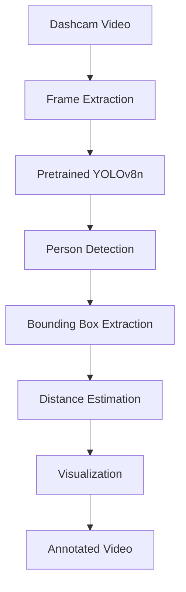

# Pedestrian Detection and Distance Estimation Using Pretrained YOLOv8

## Abstract

This mini-project implements pedestrian detection in dashcam video using the pretrained YOLOv8n
object-detection model. Only the COCO `person` class is retained. Each detection is displayed with
a bounding box, confidence score, and approximate distance calculated from bounding-box geometry.
A Streamlit interface accepts video uploads and reports processing statistics. Because a single
ordinary camera does not directly provide metric depth, the reported distance is an estimate rather
than ground-truth measurement.

## Introduction

Pedestrian awareness is a useful computer-vision task for intelligent transportation and driver
assistance. Real-time detectors can identify people in each frame, while geometric assumptions can
provide a useful indication of relative distance.

## Problem Statement

Detect pedestrians in a sample dashcam video using pretrained YOLOv8, draw bounding boxes, estimate
approximate distance, and generate an annotated output video through a simple web interface.

## Objectives

1. Use YOLOv8n without training a model from scratch.
2. Keep only pedestrian detections.
3. Overlay confidence and approximate distance.
4. Preserve video dimensions and frame rate where possible.
5. Provide a clear, locally runnable Streamlit application.

## Technologies Used

Python 3, Ultralytics YOLOv8, OpenCV, NumPy, Streamlit, and Pandas-compatible Python tooling.

## System Architecture

## Methodology

The application opens the input video with OpenCV, reads one frame at a time, and passes each frame
to YOLOv8n. Inference is restricted to class ID 0, the COCO person class. For every detection, the
pixel height of the box is used to estimate distance. The annotated frame is written to an MP4
video writer, and counters are updated for the UI summary.

## YOLOv8 Overview

YOLO (You Only Look Once) performs object detection in a single forward pass. YOLOv8n is the small,
fast pretrained variant used here. Ultralytics provides the model interface and pretrained weights;
the project does not perform custom training.

## Pedestrian Detection

The detector applies a configurable confidence threshold and passes `classes=[0]` to the Ultralytics
predict call. The returned coordinates are converted to integer pixel positions for OpenCV drawing.

## Distance Estimation Method

For a pedestrian whose real height is approximated by `H`, and whose bounding box has pixel height
`h`, the pinhole model provides:

## Mathematical Formula

`Distance = (H × F) / h`

where `H` is assumed real-world pedestrian height, `F` is camera focal length in pixels, and `h` is
the pedestrian bounding-box height in pixels. The focal length can be estimated from one known
observation:

`F = (h × known distance) / known height`

## Implementation

- `src/detector.py` loads YOLOv8n and returns person detections.
- `src/distance_estimator.py` contains the formula and optional focal-length calibration helper.
- `src/video_processor.py` performs frame reading, annotation, writing, and statistics collection.
- `app.py` provides upload controls, settings, progress, previews, downloads, and metrics.

## Application Workflow

1. Start Streamlit and upload a dashcam video.
2. Set confidence, assumed height, and focal length.
3. Select **Process video**.
4. The application loads YOLOv8n, processes frames, and overlays results.
5. Review statistics and download the annotated video.

## Results

The implementation and repository consistency checks were completed in the available workspace.
A Python runtime and dashcam video were not available during project construction, so import,
model-load, video-processing, and Streamlit-startup tests could not be executed and no fabricated
detection counts or FPS values are reported here. Insert measured values after running with real input:

- Total frames processed: `[Insert measured total frames after testing]`
- Total pedestrian detections: `[Insert measured detections after testing]`
- Maximum pedestrians in one frame: `[Insert measured maximum after testing]`
- Processing FPS: `[Insert measured processing FPS after testing]`

## Limitations

Monocular geometry cannot guarantee true metric depth. Results depend on focal-length calibration,
assumed human height, camera angle, perspective, lens characteristics, occlusion, and box accuracy.
The current version does not track identities or correct for camera motion.

## Future Improvements

Camera calibration, lens-distortion correction, ground-plane geometry, temporal tracking, a more
accurate depth model, and GPU inference could improve accuracy and performance.

## Conclusion

This project demonstrates a clean end-to-end pedestrian-detection workflow using a pretrained
YOLOv8 model. It produces understandable visual output and exposes the important limitations of
distance estimation from a single uncalibrated camera.

## References

1. Ultralytics, “Ultralytics YOLO Documentation,” https://docs.ultralytics.com/
2. T.-Y. Lin et al., “Microsoft COCO: Common Objects in Context,” ECCV, 2014,
   https://cocodataset.org/
3. R. Hartley and A. Zisserman, *Multiple View Geometry in Computer Vision*, 2nd ed., Cambridge
   University Press, 2004.
